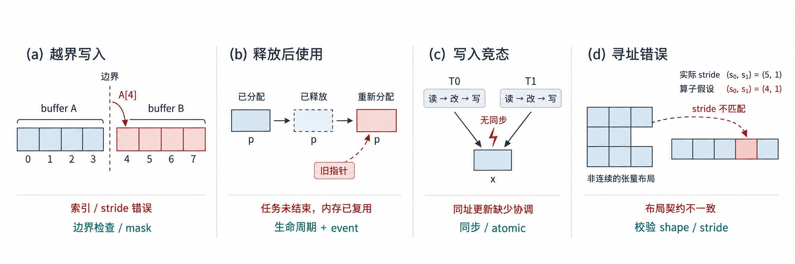
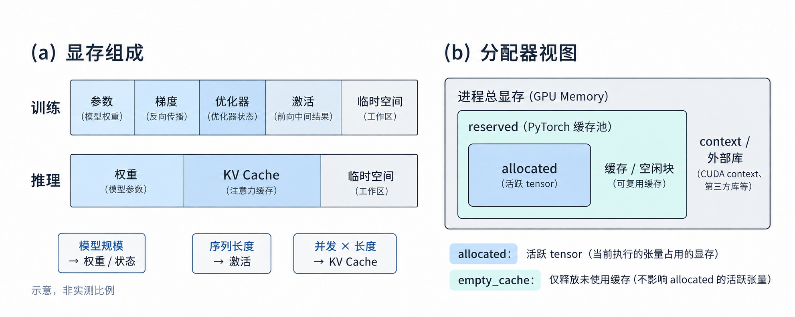
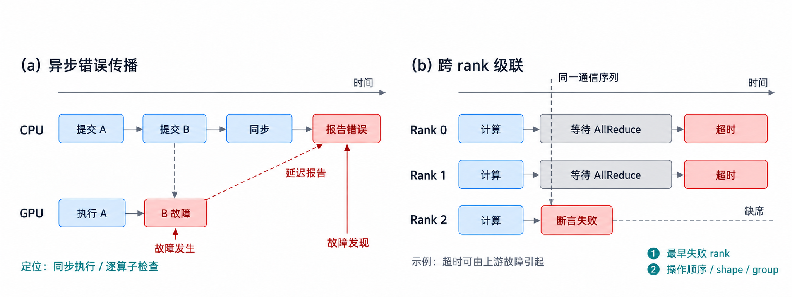
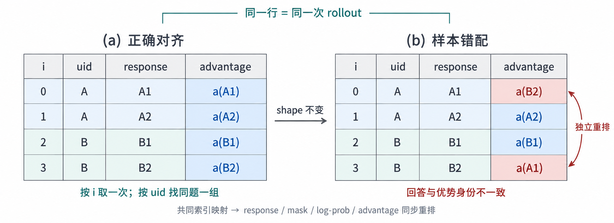

# 模型训练与推理常见报错：从现象到根因的排查方法

> 阅读目标：看到 OOM、CUDA 报错、NaN 或 NCCL 超时后，知道先收集什么证据、怎样缩小问题范围，以及修复后如何验证。
> 资料核验：2026-10-13。以 PyTorch + NVIDIA CUDA 为主要示例，涉及 NCCL 的命令用于支持该后端的 Linux/GPU 环境；Ascend、其他设备及不同版本需要对照相应后端文档。
> 本文是排查指南，图和案例均为教学示意；没有针对某个真实故障作诊断，也没有在本机执行 GPU/集群实验。命令中的 `repro.py` 是你需要准备的最小复现脚本，不是本仓库已有文件。

模型报错的最后一行通常说明“哪里发现问题”，未必说明“哪里制造问题”。一个错误索引可以让 GPU kernel 断言失败；该 rank 随后退出，其他 rank 等不到 collective，最后留下 NCCL timeout。只读最后一条超时日志，就会把数据问题误判成网络问题。

因此，排查首先要建立因果顺序：保留原始失败现场，寻找各进程最早的异常，再按证据逐步减少数据量、设备数和优化路径。改动后能跑通只是第一步，还需要证明计算语义正确。

## 1. 先用现象分类，但不要直接下结论

| 典型现象或错误片段 | 首先考虑 | 最小证据 | 常见误判 |
| --- | --- | --- | --- |
| `CUDA out of memory` | 显存容量、峰值、持有引用、其他进程 | 阶段、长度、并发、allocated/reserved、进程显存 | 一律当作内存踩踏或碎片 |
| `device-side assert triggered` | token/label/index 越界，算子前置条件 | 失败样本 ID、CPU 上的索引范围、同步 traceback | 在已失败 CUDA 进程里继续查询张量 |
| `illegal memory access` | 越界访问、失效指针、生命周期、底层算子缺陷 | 最小 kernel 路径、shape/stride、memcheck | 认定 traceback 那一行就是出错算子 |
| `mat1 and mat2 shapes cannot be multiplied` | 张量语义、转置、并行分片 | 算子两侧 shape 与轴含义 | 用任意 reshape 强行通过 |
| device / dtype mismatch | 张量放置、精度和算子接口 | 每个输入的 device、dtype | 把 token IDs 也转成半精度 |
| loss / grad / logits 出现 NaN、Inf | 非法数学运算、低精度溢出、mask/reward 异常 | 第一个非有限值及其上游输入 | 用 `nan_to_num` 隐藏错误 |
| in-place / backward graph 错误 | autograd 图被修改、重复反向 | 反向失败节点与前向来源 | 全局加 `retain_graph=True` |
| NCCL watchdog timeout / hang | rank 先失败、collective 不一致、网络或资源 | 所有 rank 的第一处错误及 collective 序列 | 只增大 timeout |
| DataLoader worker exited / 程序被 killed | 数据解码、CPU RAM、共享内存、worker 生命周期 | 单 worker 样本复现、主机及容器日志 | 只减 GPU batch 或认定 GPU OOM |
| checkpoint missing / unexpected keys、导入失败 | 模型结构、依赖、分片格式和环境 | 完整加载错误、版本、权重来源 | `strict=False` 或升级所有依赖掩盖问题 |
| 不报错但 reward/质量异常 | 样本错配、mask、模板、概率和版本不一致 | 可重放 rollout、逐字段对齐 | loss 下降就认定训练正确 |

## 2. 内存踩踏：为什么上层模型会报错

“内存踩踏”通常指非法写入破坏其他内存。非法读取也可能产生 `illegal memory access`，但未必写坏数据；并发竞态可能在合法地址内破坏结果，也不一定越界。因此，“非法访问”“数据损坏”“内存踩踏”相关，但不能完全互换。



图 1：四类失效机制及修复切入点。蓝色为合法数据区域，红色强调错误访问或依赖，青色为修复方向；竞态发生在合法地址内，不必越界。右图的 stride 数值仅示意接口假设不一致，并非从图中网格推导的真实张量布局。

### 2.1 越界写入：算子的地址越过有效区域

假设 buffer A 只有四个元素，合法索引是 `0..3`。自定义 kernel 把 `A[4]` 当成合法输出，可能写到邻近区域，也可能直接触发非法访问。邻近区域属于什么、是否立即报错，取决于实际分配和运行状态；图中的相邻 buffer 是示意布局。

常见原因包括：尾块没有边界 mask，混淆元素数量与字节数量，转置后仍沿用旧 stride，或变长序列长度与真实 buffer 不一致。修复应恢复合法的地址计算；仅扩大 buffer 可能只是把越界隐藏起来。

### 2.2 释放后使用：指针还在，内存已经归别人

异步 kernel 仍准备使用一块内存，另一个执行路径已经释放或复用了它。旧指针随后访问新用途的数据，就可能破坏别的张量。自定义 stream、异步通信和原生扩展中的生命周期管理值得重点检查。

应明确“谁拥有 buffer、谁还在使用、何时可释放”，按实际依赖使用 event/stream 等待及框架生命周期机制。不能把 PyTorch 正常缓存复用直接认定为缺陷；问题在于未正确表达的使用依赖。

### 2.3 并发写入竞态：地址合法，顺序不合法

两个线程对同一位置执行需要协调的读改写，却没有同步或原子操作，可能丢失更新或得到不确定结果。修复需要明确输出所有权，或按算法使用同步、归约与 atomic；atomic 也不会自动修复所有执行顺序和浮点确定性问题。

### 2.4 原生算子接口错误：上层 tensor 与底层假设不一致

模型给出非连续 tensor，kernel 却按连续布局寻址；或 dtype、元素大小、长度计算发生错误。Python 层可能只看到普通模型调用，但破坏发生在 C++/CUDA/Triton 等底层路径。

检查 shape、stride、dtype、device、对齐、长度和所有权契约，比较参考实现与优化算子。临时换回参考路径可用于隔离原因；正式修复仍需验证输出与梯度。

### 2.5 检测工具各管哪一层

NVIDIA Compute Sanitizer 的 `memcheck` 用于定位设备越界及非对齐访问；`racecheck` 主要检查 shared memory 数据访问竞态，不能据此排除所有 global memory 或跨 stream 竞态。原生 CPU 代码可用 AddressSanitizer 等工具辅助定位。工具能力和选项应核对目标版本。[NVIDIA Compute Sanitizer 手册](https://docs.nvidia.com/compute-sanitizer/ComputeSanitizer/index.html)

在支持 CUDA 工具链的复现环境中，可分别运行：

```bash
compute-sanitizer --tool memcheck python repro.py
compute-sanitizer --tool racecheck python repro.py
```

预期获得访问类型、kernel 和调用位置等线索；不是一次“无错误”运行就能证明所有输入安全。非法访问或设备断言后，应保存日志并重新启动失败进程，再做下一次实验。

## 3. OOM：先回答“谁在什么时候占了多少”



图 2：左图比较训练与推理的显存组成，条带长度和色块大小不代表实测比例，也不表示二者总占用相等；右图展示分配器管理范围。优化器状态创建后通常持续存在，梯度释放时机取决于训练实现。

### 3.1 训练与推理的显存账本不同

训练需要参数、梯度、优化器状态、保存的 activation、临时 workspace 和通信 buffer。首次 optimizer step 才创建状态、长样本增加 activation、分片参数临时 gather，都可能制造阶段性峰值。

推理主要关注权重、KV Cache、临时 activation/workspace、图捕获等资源。prompt/output 长度、同时在途请求数和 rollout 多采样共同影响 KV 使用。GRPO 去掉 critic 后，增加的 rollout 数量仍可能让生成侧 OOM；Actor、Reference 与 Rollout 是否共置也影响峰值。

### 3.2 区分 allocated、reserved 与进程总显存

PyTorch 的 `memory_allocated()` 主要反映活跃 tensor 占用，`memory_reserved()` 反映缓存分配器管理的显存。`nvidia-smi` 看到的进程显存还可能包含 CUDA context 和其他库分配。reserved 高于 allocated 不自动证明泄漏或碎片；`empty_cache()` 不能释放仍被活跃 tensor 使用的内存。[PyTorch CUDA 显存管理](https://docs.pytorch.org/docs/main/notes/cuda.html#memory-management)

排查时记录每个 rank 在加载、rollout、forward、backward、optimizer step、权重同步前后的当前及峰值显存，并关联序列长度与有效 token 数。如果每步基线持续增长，检查保留计算图的日志列表、缓存和对象引用；如果只在长样本上瞬时失败，优先检查容量峰值。需要更细粒度证据时，可按官方说明采集 allocator snapshot；它不覆盖所有外部显存分配。[显存快照说明](https://docs.pytorch.org/docs/stable/torch_cuda_memory)

### 3.3 根据占用者选择修复

| 主要占用者 | 候选措施 | 必须保留的语义检查 |
| --- | --- | --- |
| activation | 减 microbatch、按长度分桶、激活重计算 | 总 batch 与 loss 归约仍符合原设计 |
| 参数/梯度/优化器 | 状态分片、offload、支持的低精度方案 | 后端兼容、数值与恢复正确性 |
| KV Cache | 限在途并发与长度、调整 rollout 批次、容量调度 | 截断比例、完成率、TTFT/TPOT |
| 长期持有图或 tensor | 去掉不必要引用，日志保存 detached 标量 | 未意外截断需要的梯度 |
| 临时重叠峰值 | 调整共置/同步时序及资源预算 | 下一轮 rollout 权重已正确生效 |

修复后用相同失败样本及长度上界重跑，记录峰值和剩余余量。减 batch 可能改变有效训练 batch；若希望保持它，应同步核对梯度累积与 loss 缩放。

## 4. device-side assert：先检查索引与标签

Embedding 的 token ID 必须落在其词表范围内。tokenizer 新增 token、模型 embedding 未相应调整，或错误把标签中的 `-100` 当成 input token，可能导致越界。分类索引标签还需要符合 loss 的类别范围。

CrossEntropyLoss 在类别索引模式下接受 `[0, C)` 的标签以及配置的 `ignore_index`；LLM 常用 `-100` 忽略部分标签，这个值是 loss 契约的一部分，不是合法的 embedding token ID。对于 `[B, L, V]` logits，要按 loss 接口正确调整类别轴或展平，不能把时间轴误当类别轴。[CrossEntropyLoss 接口](https://docs.pytorch.org/docs/stable/generated/torch.nn.CrossEntropyLoss.html)

最小排查顺序：保存样本 ID 和送入 GPU 前的输入；在 CPU 检查 min/max、dtype、词表大小及非忽略标签；缩到单个样本；同步定位出错算子。CPU 路径可能给出更直接的范围错误，但不同 kernel 的行为不保证相同。

CUDA 默认异步执行，可在独立调试进程里启用同步，帮助 traceback 更接近真实出错调用；它会影响性能与时序，不应作为性能测试配置。[CUDA 环境变量](https://docs.pytorch.org/docs/stable/cuda_environment_variables.html)

```powershell
# Windows PowerShell，子进程退出后恢复原环境配置。
$previousLaunchBlocking = $env:CUDA_LAUNCH_BLOCKING
try {
    $env:CUDA_LAUNCH_BLOCKING = '1'
    python repro.py
} finally {
    $env:CUDA_LAUNCH_BLOCKING = $previousLaunchBlocking
}
```

Linux 可对单次启动使用 `CUDA_LAUNCH_BLOCKING=1 python repro.py`。同步后预期看到更靠近失败算子的调用位置；仍需结合输入契约验证，而不是直接认定为内存踩踏。

## 5. shape、dtype、device：先写出每条轴的含义

`[B, L, H]` 与 `[B, H, L]` 元素总数相同，语义却不同。矩阵乘法需要收缩维度匹配，attention 还要核对 head 数、head dimension、KV heads、mask 广播和位置编码。先在失败算子边界记录输入输出 shape 与轴名，再检查 reshape/transpose；不能以“元素总数相同”为理由随意变形。

dtype 也不是统一转成 FP16 就能解决：索引通常需要整数，mask 依接口可能是布尔或数值，模型计算精度与量化布局另有约定。device 错误常来自临时 tensor 在 CPU 创建、checkpoint 加载位置不一致，或 rank 选错本地设备。修复应符合模型并行的预期放置，不能把所有张量粗暴搬到同一 GPU。

`view` 在某些非连续布局上不能成立；`reshape` 可能分配拷贝。它们修复布局条件，不代表修复轴语义。对于自定义 kernel，接口需明确是否支持非连续输入，只有必要时才转成符合契约的连续布局。

验证除了 shape 合法，还应检查几个可手算的数值、token 顺序及参考实现输出，必要时比较梯度。错误的广播可能完全不报错，却沿错误维度计算 loss。

## 6. NaN / Inf：找第一个失去有限性的边界

常见候选原因是除零、对非正数取 log、低精度溢出、过大 logits/梯度、不合法输入，以及自定义 masked mean 的分母为零。应沿数据 → 模型输出 → loss → 梯度 → optimizer 更新检查有限性，记录最先异常的阶段，而不是只看最终 loss。

对于 RL，再检查 reward 分解、有效 response token 数、组内标准差、advantage 和 log-prob 差值。GRPO 同组奖励全相同时，常见正确实现产生零优势或通过稳定处理避免除零；自定义代码直接除标准差才可能 NaN。PPO 中 `exp(new_log_prob - old_log_prob)` 还可能放大异常概率差。

处理方向取决于证据：修复非法样本与空 mask；为数学边界定义明确语义；在易溢出环节使用合适精度；检查学习率、梯度裁剪和 AMP。降低学习率不能修复索引错误，随意 clamp 则可能改变训练目标。

`torch.autograd.detect_anomaly(check_nan=True)` 可在调试时关联反向失败与对应前向，并检查反向产生的 NaN；它不替代 forward/reward 的有限性检查，也不是全面的 Inf 检测器。[autograd 异常检测](https://docs.pytorch.org/docs/main/autograd.html#debugging-and-anomaly-detection)

使用 FP16 GradScaler 时，在修改或裁剪梯度前应先 unscale；每个 optimizer 的 unscale 时机要与梯度累积和 step 对齐。BF16 是否使用 scaler 取决于实际方案，不能照搬 FP16 流程。[AMP 梯度裁剪示例](https://docs.pytorch.org/docs/stable/notes/amp_examples.html#gradient-clipping)

修复验收：相同失败 batch 上 forward、loss、梯度与更新后参数均有限；重复若干次更新，检查 grad norm、loss 和 reward 的趋势，再恢复原精度与并行路径逐项比较。

## 7. autograd 错误：计算图何时被修改或释放

`one of the variables needed for gradient computation has been modified by an inplace operation` 常意味着反向需要的中间值已被原地修改。先用异常检测找到相关前向，检查切片赋值、带下划线操作和共享 storage 的别名；对原地操作做语义等价的修复，而不是仅删除报错检查。

`Trying to backward through the graph a second time` 需要检查是否错误复用上一步 loss/hidden state、重复 backward，或在序列之间无意连接了计算图。若确实需要多次反向，要设计好图生命周期；无条件 `retain_graph=True` 会保留图并增加显存。`detach()` 同样需要符合目标：它会切断梯度，不能作为通用消错按钮。

如果 loss 没有 `grad_fn`，检查参数是否冻结、是否进入 no_grad、是否将值转成 Python 标量再重建 tensor。RL 中 reward、old policy 概率常按设计固定，但当前 actor log-prob 必须按所用目标保留梯度路径。验证预期参数收到梯度，冻结参数保持冻结。

## 8. NCCL 超时：网络问题与计算问题要分开证伪



图 3：左图区分 GPU 故障发生与 CPU 后续发现错误的位置，右图展示某个 rank 未进入 collective 引起的级联等待。超时只是这条示例路径的后果，实际诊断仍需排除网络与资源问题。

下面是一个教学时间线，箭头表示可能的因果链，不是所有 timeout 的共同原因：

```mermaid
flowchart LR
    A[Rank 2：错误标签] --> B[GPU 断言失败]
    B --> C[Rank 2 未进入下一次 AllReduce]
    C --> D[其他 rank 等待 collective]
    D --> E[最后报告 NCCL timeout]
    F[排查：保留所有 rank 日志] --> G[定位最早异常与操作序列]
    G --> A
    classDef normal fill:#BFD7FF,stroke:#0B4DB8,color:#111827;
    classDef fault fill:#F38A73,stroke:#0B4DB8,color:#111827;
    classDef wait fill:#F4C55E,stroke:#0B4DB8,color:#111827;
    classDef action fill:#79CFC5,stroke:#0B4DB8,color:#111827;
    class A normal;
    class B,C,E fault;
    class D wait;
    class F,G action;
```



### 8.1 先查各 rank 是否走了相同的通信协议

同一 process group 的 collective 必须按对应协议调用：操作类型、顺序、参与成员及所需 shape/count 一致。某个 rank 因为空 batch 跳过 update、某个分支额外调用 AllReduce、All-to-All split sizes 不匹配，都可能导致挂起。

MoE 要核对 EP group，而不是误用整个 world group；PP 要核对相邻 stage 的 send/recv 对应和 shape。记录 rank、group 成员、step、操作序号、类型、shape/dtype 及 A2A split sizes，避免只记录 rank 0。

PyTorch 分布式调试可增加 collective 一致性检查；NCCL 日志用于观察初始化和通信线索。详细模式有额外开销，应仅用于复现。[PyTorch distributed 调试说明](https://docs.pytorch.org/docs/stable/distributed.html)

```bash
# Linux，替换为你的最小双卡脚本。
NCCL_DEBUG=INFO TORCH_CPP_LOG_LEVEL=INFO TORCH_DISTRIBUTED_DEBUG=DETAIL \
  torchrun --standalone --nproc-per-node=2 repro.py
```

### 8.2 再查资源与网络；超时阈值放到最后

单卡同样失败，先修模型/数据路径；双卡最小 collective 都失败，再缩到驱动、网络、容器与通信环境。检查 rank 到 GPU 的绑定、节点间可达性、接口选择、共享内存资源和互联拓扑，按 NCCL 官方故障分类逐项验证。[NCCL Troubleshooting](https://docs.nvidia.com/deeplearning/nccl/user-guide/docs/troubleshooting.html)

不要同时设置一串禁用 P2P/IB 的变量。改变传输方式可作受控对照，但可能绕过问题并降低性能。增大 timeout 只适合已经证明是合法慢操作的情况，不能修复缺席 rank 或错误通信协议。

### 8.3 使用版本支持的通信事件记录

支持 Flight Recorder 的 PyTorch 版本可以保存 collective 事件。`TORCH_NCCL_DUMP_ON_TIMEOUT=1` 需配合大于零的 `TORCH_NCCL_TRACE_BUFFER_SIZE`；检查安装版本的变量支持、输出目录权限及各 rank 文件，再分析谁停在哪个操作。[ProcessGroupNCCL 环境变量](https://docs.pytorch.org/docs/2.14/torch_nccl_environment_variables.html)、[Flight Recorder 教程](https://docs.pytorch.org/tutorials/unstable/flight_recorder_tutorial.html)

修复后从单节点小规模开始，恢复原 world size 和失败 batch，核对每个 rank 的完整 step、梯度/权重一致性与通信耗时。仅“没有 timeout”不足以证明正确同步。

## 9. 数据、依赖、checkpoint 与推理服务的常见问题

### 9.1 DataLoader worker 异常或主机进程被 killed

先用 `num_workers=0` 运行同一数据路径，取得主进程 traceback 并记录失败样本。worker 多时，预取、解码后对象和 pinned memory 会增加 CPU RAM 压力；容器共享内存不足也可能表现为 worker 崩溃。没有 Python traceback 的 killed 需检查主机/容器退出信息和 OOM killer 等证据，不能直接当作 GPU OOM。

修复损坏样本或解析逻辑，再按证据调整 worker 数、预取和资源限制。Linux 下 fork 与 CUDA 初始化的组合也值得核对；CPU 数据准备与 GPU 执行应有清楚边界。验收时既检查完整数据读取，也检查样本数量和顺序，避免静默跳样本。

### 9.2 环境、ABI 和设备兼容

`undefined symbol`、动态库加载失败、`no kernel image is available for execution on the device` 等，需要检查当前 Python 环境、PyTorch 构建版本、驱动、设备架构以及扩展构建目标。`nvcc` 的版本、框架携带的 CUDA runtime、GPU 驱动是不同信息，不能用一个版本号代表全部环境。

保留精确错误文本和版本清单，对照失败组件的安装要求；在隔离环境先跑最小导入及算子，再恢复应用。避免同时升级所有依赖，否则无法判断是哪一个变化解决问题。

### 9.3 checkpoint：加载成功不等于恢复完整

missing/unexpected keys 应逐项核对结构、前缀、模型配置和分片格式。`strict=False` 可用于有意的部分加载，但必须解释哪些权重被忽略；它不保证同名参数的 shape mismatch 被容忍。[PyTorch 模型保存与加载](https://docs.pytorch.org/tutorials/beginner/saving_loading_models.html)

恢复训练还应核对 optimizer、scheduler、AMP 状态、step、随机状态和数据进度是否按目标恢复。权重能前向，只证明模型加载的一个层面；验收应包含恢复后的下一步更新与不中断基线的受控对照。磁盘不足或文件不完整也要从最早的保存错误追查。

### 9.4 服务超时与“看起来卡住”

请求超时可能发生于 queue、prefill、decode、工具执行、流式传输或客户端。区分“没开始生成”和“生成了但客户端没收到”，记录 request ID、排队时间、TTFT、输出 token 间隔、结束原因与取消行为。

用短请求、单并发建立基线，逐步恢复输入长度与并发。若 GPU 忙于长 prefill，要检查调度；若 GPU 空闲且工具调用未返回，要检查环境路径；若引擎已完成而客户端无响应，要检查服务链路。仅延长 HTTP timeout 无法提高有效吞吐。指标与容量可参考[推理容量与可观测性](../../RL_go/blog/inference/observability-and-capacity.md)。

## 10. 不报错却算错：verl / Agentic RL 特别要检查的契约



图 4：`a(A1)` 表示 A1 这次 rollout 对应的优势数据。右表单独交换 A1/B2 的优势，行数与 shape 均保持不变，但回答和训练信号已错配。任一样本字段独立重排都可能造成同类错误；token 位置和 prompt 分组还需分别检查。

这一类问题常表现为 reward 波动、KL/ratio 异常、质量退化或工具行为重复。它们需要数据和语义证据，内存检测工具通常帮不上忙。

| 契约 | 可能失效的情形 | 排查方法 |
| --- | --- | --- |
| 样本身份 | responses 被 reorder，reward/uid 未同步 | 逐行比对 rollout ID；同一索引指向同一次 rollout |
| prompt 分组 | GRPO 同题多采样分组错误 | 按 uid 检查题目一致性、组大小和原始 reward |
| token 位置 | log-prob 与 next-token target 偏移一位 | 手工检查短序列的 context、target 与位置 |
| mask | prompt/padding/tool observation 错算入 actor loss | 标明模型动作 token；按训练目标核对有效 token 计数 |
| 概率来源 | 混用 old、reference 与 rollout log-prob | 记录计算角色、权重版本和采样变换 |
| 训推输入 | chat template、tokenizer、截断等不一致 | 比较实际 token IDs 和相同位置的 log-prob |
| 异步策略 | rollout 来自过旧策略，修正不匹配 | 记录策略版本差、样本年龄和 correction 指标 |
| reward/环境 | verifier 异常被当成零分，工具超时混入失败 | 分开任务失败、工具失败与基础设施失败 |

第 0 维只说明“一批样本”的排列方向，不编码 prompt 身份。比如四行 `uid=[A,A,B,B]`，索引 2 取的是 B1 这次 rollout；找 `uid=B` 才得到 B1、B2 两条经验。shape 全部一致却顺序错配，会造成错误训练信号，通常不会直接内存踩踏。详见[DataProto 第 0 维对齐示例](../../RL_go/blog/verl-training-lifecycle.md#第-0-维为什么必须一致一行对应一次-rollout)。

Agentic RL 中，工具 observation 通常作为下一次动作的上下文，并非模型采样的动作；是否进入 loss 必须按具体目标定义。保存工具输入输出、环境状态、策略版本、终止原因和 mask，才能重放轨迹、重算 reward，并区分算法问题与环境问题。详见[Agentic RL 专题](../../RL_go/docs/agentic-rl.md)与[训推一致性](../../RL_go/blog/reinforcement-learning/training-inference-consistency.md)。

## 11. 一套可重复的排查与验收流程

1. **固定现场**：保存完整 traceback、所有 rank 日志、样本/请求 ID、配置、源码 commit、依赖与设备版本；记录首次失败的阶段和 step。
2. **建立时间线**：找最早异常，区分 CUDA 延迟报告、其他 rank 的后续 timeout，以及失败后的级联错误。
3. **缩小但保留触发条件**：减少样本、设备和组件，一次只改一个变量。若问题只在特定长度、并发或精度发生，不应把这些条件删光后就宣布解决。
4. **选对应工具**：容量用显存统计；索引用输入范围和同步 traceback；非法访问用 sanitizer；数值用边界有限性；通信用操作序列和网络证据；静默错配用样本与版本契约。
5. **修根因并反向验证**：修复应解释为什么此前失败；在相同输入上比较参考输出、梯度或任务结果。
6. **恢复原工作负载**：重新测试原长度、并发、world size 与优化路径，记录正确性、峰值显存和性能。结束时移除调试配置，避免把同步/检测开销算成系统性能。

建议每次留下以下简短记录，方便一个月后复习，也方便他人复现：

```text
错误原文 / 第一个失败 rank 与阶段：
环境版本 / 源码提交 / 后端与并行配置：
最小复现命令 / 失败样本与触发条件：
已验证的原因 / 已排除的假设：
修复内容 / 相同输入上的正确性验证：
恢复原规模后的显存、性能与剩余限制：
```

本篇交付的是排查方法和学习材料。没有本地 GPU/集群日志时，只能说明可能原因和验证路径，不能把教学案例当作某次真实故障的根因证明。
