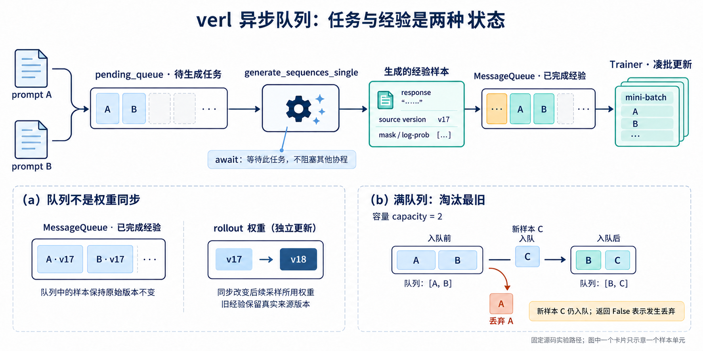

# verl 异步训推代码导读：一条经验怎样入队、出队与凑批

> 日期：2026-10-14。状态：源码导读与 CPU 队列实验完成，课后题待回答。
> 固定源码：`verl@c4b389adadc58ce51cb2b63e70df497ca166d77f`；本课选取 `verl/experimental/fully_async_policy`。
> 路径边界：这是实验设施，不是此前同步 `RayPPOTrainer.fit()` 的默认行为，也不与 `trainer/ppo/v1` 的 ReplayBuffer/TransferQueue 实现混用。
> 前置讨论：[生成权重滞后与队列等待](verl-weight-version-and-sync.md#异步延伸-qav17-的待处理经验从哪里来)。代码均为真实语句的节选或明确标注的教学实现；真实 Ray/GPU 路径未运行。

## 1. 先从最小例子理解队列

```python
from collections import deque

queue = deque()
queue.append({"name": "A", "source_version": 17})
queue.append({"name": "B", "source_version": 17})
experience = queue.popleft()  # 取出 A；队列剩 B
```

这是 FIFO：先入先出。`append` 将样本放到队尾，`popleft` 取出队头。读取队列不会修改样本来源版本；生成引擎稍后切到 v18，也不会自动改变两个字典中的 17。

只用 deque 还没有完整的异步等待语义。队列为空时，消费者应等待新经验，同时允许其他协程运行；共享操作还需适当协调。

## 2. 先区分两个队列，再看真实调用链



图中卡片为教学抽象。实际队列元素是 `RolloutSample` 的序列化记录，其 `full_batch` 是 DataProto，可包含一组数据，而不是保证每个元素恰好一条回答。`source_version` 是图示名字；本实现的数据使用 `min_global_steps` / `max_global_steps` 等元数据追溯版本。

| 位置 | 内容状态 | 不应混淆 |
| --- | --- | --- |
| `pending_queue` | 尚待处理/生成的输入任务 | 不是已经生成好的旧经验队列 |
| `active_tasks` | 正在执行的生成任务 | 不保证已经得到完整回答 |
| `MessageQueue.queue` | 已完成生成，等待 Trainer 消费的样本载荷 | 权重同步不会自动改写其中的历史经验 |
| `queue_samples` | Trainer 本次已取出、准备组装的样本列表 | 已出队，但还不等于已经参数更新 |

## 3. 生产者：从生成结果到入队

真实入口是 `FullyAsyncRollouter._process_single_sample_streaming()`，节选为：

```python
ret = await self.async_rollout_manager.generate_sequences_single(
    rollout_sample.full_batch
)
rollout_sample.full_batch = ret

success = await self.message_queue_client.put_sample(
    sample=ray.cloudpickle.dumps(rollout_sample),
)
```

[生成与入队源码](https://github.com/verl-project/verl/blob/c4b389adadc58ce51cb2b63e70df497ca166d77f/verl/experimental/fully_async_policy/fully_async_rollouter.py#L991-L1015)。周围还设置 `uid`、采集状态等；这里省略以关注数据流。

逐句理解：

1. `rollout_sample.full_batch` 起初携带生成所需输入。
2. `await generate_sequences_single(...)` 等待这个任务完成，返回生成数据。可等待的 I/O/服务调用期间，事件循环可调度其他协程；不是自动开新线程，也不保证任意 CPU/GPU 操作都重叠。
3. 将结果写回这个 sample 的 `full_batch`。
4. `cloudpickle.dumps` 序列化 Python 对象，便于传输；不是保存模型权重、不是学习，也不负责版本修正。
5. 通过队列客户端将这个完成的样本发给 MessageQueue Ray actor。

输入任务先由 `_feed_samples()` 放入 `pending_queue`，processor 从中取出并创建并发处理任务。它与这里的“完成样本入 MessageQueue”是不同阶段。[输入任务队列](https://github.com/verl-project/verl/blob/c4b389adadc58ce51cb2b63e70df497ca166d77f/verl/experimental/fully_async_policy/fully_async_rollouter.py#L859-L875)、[RolloutSample 结构](https://github.com/verl-project/verl/blob/c4b389adadc58ce51cb2b63e70df497ca166d77f/verl/experimental/fully_async_policy/detach_utils.py#L27-L39)

## 4. 队列内部：锁、容量和唤醒

`MessageQueue` 是 Ray actor，底层使用 deque。正常入队的关键语句是：

```python
async with self._lock:
    self.queue.append(sample)
    self.total_produced += 1
    self._consumer_condition.notify_all()
```

[MessageQueue 入队](https://github.com/verl-project/verl/blob/c4b389adadc58ce51cb2b63e70df497ca166d77f/verl/experimental/fully_async_policy/message_queue.py#L54-L82)。锁保护共享队列和计数修改；`notify_all` 通知等待中的消费者重新检查条件，不代表立刻训练或修改权重。

### 满队列的真实策略：丢弃最旧，仍加入新样本

该版本在 append 前还执行容量检查：

```python
if len(self.queue) >= self.max_queue_size:
    self.queue.popleft()
    self.dropped_samples += 1
    is_drop = True
self.queue.append(sample)
```

若容量为 2，队列 `[A,B]` 又收到 C，结果是 `[B,C]`。A 被丢弃，C 确实入队；随后该方法返回 `False`，表示本次发生了 drop。这是当前实现的行为，不能只按函数 docstring 或变量名 `success` 推断新样本没入队。

所以不能看到 `False` 就盲目重发 C；否则可能重复入队并进一步挤掉其他样本。这个层的容量淘汰不是“阻塞生产者直到空间可用”，也不自动按策略概率差判断哪个经验最 stale；不要推广成所有 verl 队列的行为。

## 5. 消费者：空队列时等待，有样本时取出

`MessageQueue.get_sample()` 的普通取数路径：

```python
async with self._lock:
    while len(self.queue) == 0 and self.running:
        await self._consumer_condition.wait()

    # 完整源码另有关闭且为空时的退出分支。
    data = self.queue.popleft()
    self.total_consumed += 1
    return data, len(self.queue)
```

[出队源码](https://github.com/verl-project/verl/blob/c4b389adadc58ce51cb2b63e70df497ca166d77f/verl/experimental/fully_async_policy/message_queue.py#L84-L103)。Condition.wait 会释放关联锁，在被唤醒后重新获取锁；因此生产者有机会拿锁并放入数据。

这里使用 `while`，因为收到通知不保证自己最终拿到数据：其他消费者可能先取走，条件必须重新检查。返回第二项是取出之后的队列长度，不是样本版本号。

队列有积压时，取数可很快完成；队列为空时，Trainer 等待新生成。这两个状态也解释了为何“取样速度”不能直接当作“实时生成速度”。关闭/终止信号处理是另一个协议，本课不展开。

## 6. Trainer：取够样本，反序列化，再组成 batch

`FullyAsyncTrainer._get_samples_from_queue()` 用循环收集：

```python
queue_samples = []
while len(queue_samples) < self.required_samples:
    sample, queue_len = await self.message_queue_client.get_sample()
    # 本节省略终止信号与日志处理。
    queue_samples.append(sample)

queue_samples = [ray.cloudpickle.loads(x) for x in queue_samples]
batch = assemble_batch_from_rollout_samples(...)
```

[收集与组装源码](https://github.com/verl-project/verl/blob/c4b389adadc58ce51cb2b63e70df497ca166d77f/verl/experimental/fully_async_policy/fully_async_trainer.py#L375-L450)。最后一行是教学省略，完整参数依 balance 配置而变化。

假设本次 `required_samples=2`：A 到达时，列表为 `[A]`；还缺一个，再等 B；收集为 `[A,B]` 后反序列化并组装 DataProto。这里“两个”指队列样本单元，具体每个单元内有多少条 response 要看 full_batch，不能直接等同 GPU mini-batch size=2。

此函数不要求 A/B 的采样版本等于当前 Actor，也不通过读取队列就把它们变成 on-policy。后续 `_fit_generate` 接入训练流程；概率计算、优势估计、策略更新与权重同步在其他阶段执行。

## 7. 版本在哪里：随生成结果保留，不由出队时填写

batch 组装后，本版本从样本字段读取：

```python
param_version_start = final_batch.non_tensor_batch["min_global_steps"]
param_version_end = final_batch.non_tensor_batch["max_global_steps"]
trajectory_param_versions = final_batch.non_tensor_batch["max_global_steps"]
```

[版本追溯与统计](https://github.com/verl-project/verl/blob/c4b389adadc58ce51cb2b63e70df497ca166d77f/verl/experimental/fully_async_policy/detach_utils.py#L151-L172)。这里还统计轨迹版本跨度和 diversity。它们是来源与调度线索，不等于自动完成重要性修正。

例子：A/B 由 v17 生成，已入队；随后 Rollout 更新为 v18；Trainer 消费 A/B 时 Actor 已到 v19。A/B 仍带 v17 来源。若一条 partial/multi-turn 轨迹跨版本续生成，需要更细的范围与概率来源分析，不能只保留一个出队时的版本号。

## 8. 可运行实验与验证

[CPU demo](../code/async_experience_queue/demo.py) 独立实现 MessageQueue 的教学子集，去掉 Ray/模型、关闭协议等非本课部分：

```powershell
python RL_go/code/async_experience_queue/demo.py
```

它验证三件事：生成侧改成 v18 后，队列的 v17 记录不变；满队列返回 False 时新样本仍被保留；空队列消费者让出执行，生产者放入后消费者恢复。

2026-10-14 本地 Python 3.13 运行通过。完整输出与限制见[实验说明](../code/async_experience_queue/README.md)。未运行官方 Ray/GPU 路径，不推断任何真实性能提升。

## 9. 课后题：从具体状态推演

1. A 已经在 `pending_queue` 中，但还没有调用生成函数。能否把它称为“v17 生成的待训练经验”？为什么？
2. MessageQueue 容量为 2，当前 `[A(v17), B(v17)]`，收到 `C(v18)`。队列结果、返回值分别是什么？能否据返回值直接重发 C？
3. Trainer 要两个样本，目前只有 A。它 await 第二个样本时，Rollouter 是否还能继续生成 B？请说明 `await` 和 Condition 的作用。

交互状态：本轮从理论转向源码；课后题待回答，后续回答继续追加本文。
