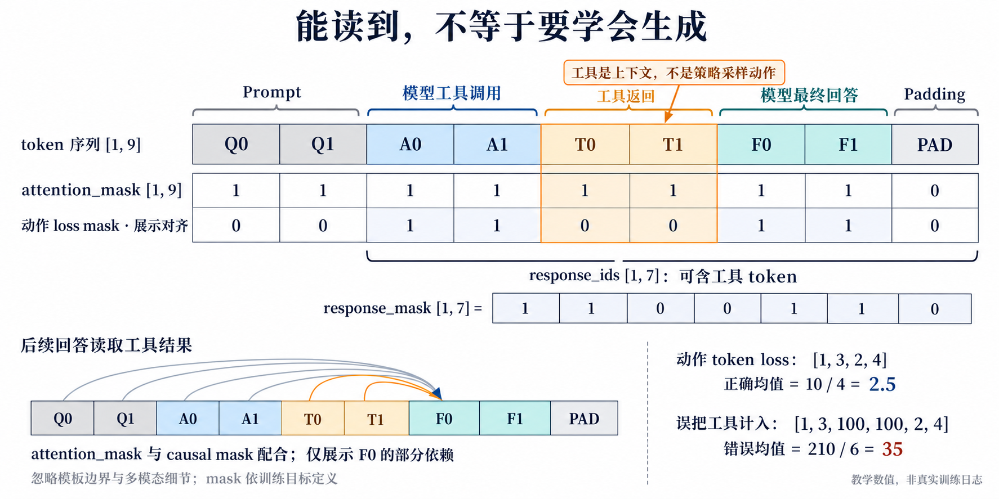

# RL 系统基础第 2 课：数据与 mask 正确性

> 日期：2026-10-14。状态：图像、静态源码核验与 CPU 实验完成；课后题待回答。
> 源码基线：`verl@c4b389adadc58ce51cb2b63e70df497ca166d77f`。选取 AgentLoop、ContinuousTokenBuilder 与 PPO loss；真实模型/GPU 未运行。
> 学习目标：区分“可作为上下文读取”与“是模型采样动作”，正确标记 prompt、工具返回、模型生成与 padding，并核对 mask 的 shape、位置和归约分母。

## 1. 同一条轨迹，有两种不同的选择

示例：用户提出问题，模型生成工具调用，工具返回结果，模型生成最终回答。我们把各段压缩成两个教学 token：

```text
Prompt       工具调用       工具返回       最终回答       Padding
Q0 Q1        A0 A1          T0 T1          F0 F1          PAD
```



图 1：每个格子代表一个教学 token，忽略真实 tokenizer、chat template 边界与多模态细节。注意力依赖示意只展示一部分；图内 loss 数值非实验日志。

**attention_mask** 常用于标记实际有效 token 与 padding，并配合 causal/block 等 attention 结构。它不是完整的因果注意力矩阵；工具结果若参与上下文，通常是有效 token。

**response_mask** 在所读 AgentLoop 路径中，选择模型生成的动作 token，用于相关策略 loss/统计。工具返回不是模型采样动作，因此在这个目标下为 0；模型生成的工具调用本身是动作，应为 1。

| 段 | attention 有效性 | 策略动作选择 |
| --- | --- | --- |
| 初始 prompt | 1 | 不作为回答动作训练 |
| 模型生成的工具调用 | 1 | 1 |
| 工具返回 observation | 1 | 0 |
| 模型生成的最终回答 | 1 | 1 |
| padding | 0 | 0 |

后续回答必须读取工具结果，但不必学习“生成这段外部工具文字”。mask=0 只排除对应位置的直接动作 loss，不意味着从上下文删掉它，也不意味着相关 embedding 参数被冻结或所有间接梯度都为零。其他训练目标如某些辅助/SFT loss 可以有不同 mask，不能一概套用。

## 2. shape：response 不一定全由模型生成

在这个单样本例子中：

```text
input_ids / attention_mask    [1,9]
response_ids                 [1,7]  = [A0,A1,T0,T1,F0,F1,PAD]
response_mask                [1,7]  = [ 1, 1, 0, 0, 1, 1,  0]
```

图中的完整动作 mask `[0,0,1,1,0,0,1,1,0]` 仅为对齐展示；真实 `response_mask` 通常只覆盖回答段。变量叫 response，不保证其中每个 token 都是采样动作。

## 3. 真实源码：先读输出契约

`AgentLoopOutput` 的字段说明直接写出区别：

```python
response_ids: list[int]
# 包含 LLM generated token 与 tool response token。
response_mask: list[int]
# LLM generated token 为 1，tool response token 为 0。
```

[AgentLoopOutput 定义](https://github.com/verl-project/verl/blob/c4b389adadc58ce51cb2b63e70df497ca166d77f/verl/experimental/agent_loop/agent_loop.py#L88-L101)。上面的注释为中文导读，不是原文逐字复制。

ContinuousTokenBuilder 对运行时 token 合并结果同步维护 mask/log-prob：插入边界 token、非 assistant token 标 0，新增 assistant token 标 1；若前缀被裁剪，元数据也一起裁剪。[align_response_metadata](https://github.com/verl-project/verl/blob/c4b389adadc58ce51cb2b63e70df497ca166d77f/verl/utils/tokenizer/continuous_token.py#L308-L350)

教学上可理解为：

```python
response_ids += generated_assistant_tokens
response_mask += [1] * len(generated_assistant_tokens)

response_ids += tool_observation_tokens
response_mask += [0] * len(tool_observation_tokens)
```

这是追加逻辑的简化；真实实现还处理 tokenization 边界与前缀修订，不能只按字符长度拼 mask。

## 4. padding 与动作身份：两项条件都要满足

AgentLoop 后处理中的真实关键语句：

```python
response_mask = response_mask_output["input_ids"] * response_output["attention_mask"]
attention_mask = torch.cat(
    [prompt_output["attention_mask"], response_output["attention_mask"]], dim=1
)
```

[后处理源码](https://github.com/verl-project/verl/blob/c4b389adadc58ce51cb2b63e70df497ca166d77f/verl/experimental/agent_loop/agent_loop.py#L734-L748)。`response_mask_output["input_ids"]` 名字容易误导：这里是通过 padding 工具处理的 mask 数值，非回答 token ID。相乘确保 padding 即使误带非零动作标记，也不计入有效位置；它不能识别误把真实工具 token 标成 1 的语义错误。

## 5. PPO loss 如何使用它

policy loss 先逐 token 计算候选 loss，最后把 `response_mask` 交给归约函数：

```python
pg_loss = agg_loss(
    loss_mat=pg_losses,
    loss_mask=response_mask,
    loss_agg_mode=loss_agg_mode,
    **config.global_batch_info,
)
```

[策略 loss 调用](https://github.com/verl-project/verl/blob/c4b389adadc58ce51cb2b63e70df497ca166d77f/verl/trainer/ppo/core_algos.py#L1363-L1372)。在单 DP、`token-mean` 且有有效 token 的简化条件下：

\[
L=\frac{\sum_t m_t\ell_t}{\sum_t m_t}.
\]

分母是被选中的有效动作 token 数，不是整条 response 长度。多 DP 时还需正确的全局有效 token 计数与缩放；其他 loss 聚合模式的语义也不同。[agg_loss](https://github.com/verl-project/verl/blob/c4b389adadc58ce51cb2b63e70df497ca166d77f/verl/trainer/ppo/core_algos.py#L1140-L1181)

教学数值：response 七个位置的 loss 是 `[1,3,100,100,2,4,999]`，正确 mask 为 `[1,1,0,0,1,1,0]`。正确均值 `(1+3+2+4)/4=2.5`；若只排除 padding，误计工具，则 `(1+3+100+100+2+4)/6=35`。这是标量归约例子，不是真实 PPO 实验，不推断其梯度或模型质量。

## 6. 一个兜底函数，不能替代 Agent 动作标记

`ray_trainer.py` 的 `compute_response_mask` 只取 attention mask 的最后 response_length 个位置：

```python
response_length = data.batch["responses"].size(1)
return data.batch["attention_mask"][:, -response_length:]
```

[兜底实现](https://github.com/verl-project/verl/blob/c4b389adadc58ce51cb2b63e70df497ca166d77f/verl/trainer/ppo/ray_trainer.py#L120-L134)。Trainer 在 `response_mask` 缺失时才调用它。单轮回答全为模型动作时，这个选择可能合适；含工具 observation 的多轮轨迹，仅凭有效 token 切片不能判断动作来源。

因此，不能因为存在自动 compute mask 就丢掉 AgentLoop 生成的动作 mask。长度一致是必要条件，语义与位置正确也要检查。

## 7. CPU 实验：跑出正确与错误归约

从仓库根目录运行：

```powershell
python RL_go/code/agent_masks_demo/demo.py
```

[代码](../code/agent_masks_demo/demo.py)与[依赖/预期输出/限制](../code/agent_masks_demo/README.md)。只需 Python 3.10+ 标准库，无模型或 GPU。2026-10-14 本地 Python 3.13 验证：有效动作数 4、正确 mean 2.5、误用 padding-only mask 为 35；改变被排除的工具位置值不改变该归约；全零动作 mask 被教学代码显式拒绝。

这里只运行归约例子，没有验证真实 tokenizer、attention、PPO 梯度或多卡 loss 缩放。masked multiplication 对 NaN 也不能无条件靠 `0` 消除，需要另行处理非有限输入。

## 8. 课后题：等待回答

1. 工具返回文本 `T0,T1`，为什么 attention 有效性为 1、动作 loss mask 却为 0？模型生成工具调用 `A0,A1` 应标几？
2. 一条 response 是 `[A0,T0,T1,F0,PAD]`，请写动作 response_mask，并说明 token-mean 的有效分母是多少。
3. 如果把工具 observation 从 input_ids 中直接删掉，只保留 mask=1 的位置，为什么可能破坏后续回答的训练？

交互记录：用户自评已吃透异步队列并要求下一知识点。前课未逐题作答不记录为题目全部验证；本课题目尚未回答。

下一主课：checkpoint 与完整恢复。若 mask 的目标/shape/上下文关系还有疑问，先在本课继续澄清。
