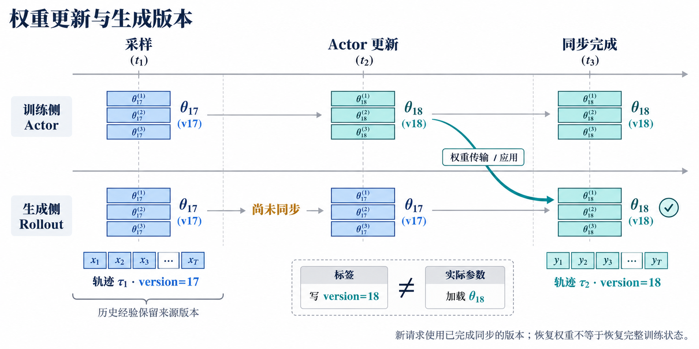
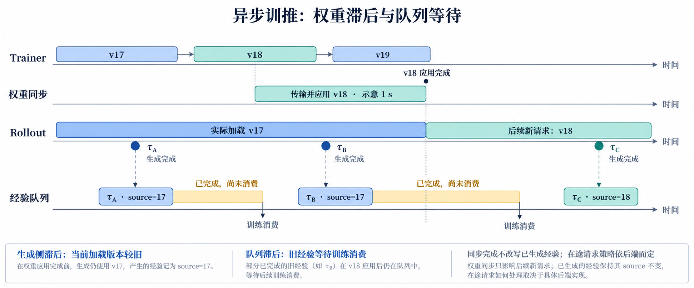

# RL 系统基础第 1 课：权重版本与训推同步

> 状态：讲解、CPU 实验与本课问答完成；真实 GPU/分布式同步未实验验证。更新时间：2026-10-14。
> 源码基线：`verl@c4b389adadc58ce51cb2b63e70df497ca166d77f`，对应本地 `RL_go/verl`，本课沿 `RayPPOTrainer` 路径。
> 学习形式：机制讲解 → 图像 → 固定版本真实代码 → 可运行教学实验 → 课后题。后续回答继续追加本文。

## 学习目标与前置条件

- 区分 Actor 当前参数、Rollout 实际加载的参数与样本来源版本。
- 沿源码找到更新后向生成侧交接权重的调用链。
- 识别“改了版本号”“只同步一部分 replica”“改写历史经验标签”的错误。
- CPU 实验仅需 Python 3.10+；真实 verl/GPU 执行还需适配的训练、推理与通信环境，本课未运行。

## 1. 核心机制：参数更新不会自动改变另一个引擎

Actor 负责更新参数，Rollout 引擎负责采样。即使二者最初加载相同模型，它们也不必引用同一份运行时参数。Actor 从 θ17 更新到 θ18 后，生成侧仍可能驻留 θ17。



图 1：同步教学时间线，蓝为 v17，青为 v18。三条参数带仅示意权重集合，不表示实际模型分片数量。样本 τ1 的来源不会因 Actor 更新而改变。新请求使用完成同步的版本；已有请求、partial rollout 与异步部署的处理需按后端另行分析。

这里有三种不同的信息：

| 信息 | 含义 | 不应误认为 |
| --- | --- | --- |
| Actor 版本 | 当前训练参数所对应的修订 | 所有 rollout replica 已加载它 |
| Rollout 版本 | 生成引擎实际采样所用的修订 | 写入一个新编号就完成权重更新 |
| 样本来源版本 | 这次采样经历对应的策略来源 | 训练时可以改写为当前 Actor 的版本 |

版本标签是追溯依据，权重同步是实际传输与应用操作。只修改标签会产生虚假的一致性；还需核验生成后端是否真正应用预期参数。标签相同也不保证 token、精度、采样变换等训推契约一致。

## 2. 真实 verl 代码：先看调用顺序

以下摘自固定版本的 `RayPPOTrainer.fit()`；为阅读省略周围日志与条件，保留关键语句。初始化先恢复训练状态，再将权重交给 Rollout：

```python
self.global_steps = 0
self._load_checkpoint()
self.checkpoint_manager.update_weights(self.global_steps)
```

入口：[ray_trainer.py，第 1401 行附近](https://github.com/verl-project/verl/blob/c4b389adadc58ce51cb2b63e70df497ca166d77f/verl/trainer/ppo/ray_trainer.py#L1401-L1405)。这保证首次生成前发生一次权重交接；不能据此将权重同步与完整恢复等同，后者还涉及 optimizer、scheduler、数据进度等状态。

正常 Actor 更新分支中，顺序为：

```python
actor_output = self._update_actor(batch)
# 中间还有按条件保存 checkpoint 等步骤。
self.checkpoint_manager.update_weights(self.global_steps)
```

入口：[Actor 更新与权重交接](https://github.com/verl-project/verl/blob/c4b389adadc58ce51cb2b63e70df497ca166d77f/verl/trainer/ppo/ray_trainer.py#L1663-L1691)。Critic warmup 是例外分支，可能只唤醒/同步 replicas，不更新 Actor。

`global_steps` 是训练步骤标签，不应无条件解释为 optimizer 更新次数或参数内容哈希：一个外层 step 可以包含多次 mini-batch 更新，也可能因 warmup 不更新 Actor。

## 3. 同步管理器：发起调用不等于全部完成

`CheckpointEngineManager.update_weights()` 根据 backend 选择同步路径。`naive` 分支直接调用 Actor worker group；下面是非 naive 分支的关键调用：

```python
await self.abort_replicas()
await self.release_kv_cache_replicas()
self.build_process_group(rollout)

results = ray.get(
    actor_wg.update_weights(global_steps=global_steps, mode=self.backend)
    + rollout.update_weights(global_steps=global_steps)
)

# 源码在恢复前还执行各 worker 的 checkpoint-engine finalize。
await self.resume_kv_cache_replicas()
await self.resume_generation_replicas()
```

入口：[base.py 的 update_weights](https://github.com/verl-project/verl/blob/c4b389adadc58ce51cb2b63e70df497ca166d77f/verl/checkpoint_engine/base.py#L506-L558)。源码顺序体现请求协调、cache 生命周期、发送/接收、完成等待和恢复。`ray.get` 等待相应任务完成；它本身不证明任意后端在任何故障下都能实现原子切换或内容校验。

Rollout worker 再将接收的权重交给后端 adapter：

```python
weights = self.checkpoint_engine.receive_weights(global_steps=global_steps)
await self.server_adapter.update_weights(
    weights,
    global_steps=global_steps,
    wire_format=getattr(self.checkpoint_engine, "wire_format", "named_tensors"),
)
```

入口：[接收与应用权重](https://github.com/verl-project/verl/blob/c4b389adadc58ce51cb2b63e70df497ca166d77f/verl/checkpoint_engine/base.py#L355-L361)。继续往下读应核对具体 adapter 的权重布局、dtype、等待与 cache 处理，不能把这个接口当成只有“改编号”的操作。

本版本 vLLM server 的输出 extra fields 携带 `global_steps`，`llm_server.py` 还处理 `min_global_steps` / `max_global_steps`。这些是追溯线索，不是每条历史轨迹可随意改成当前版本的理由，也不自动保证跨版本继续生成的轨迹只有一个策略来源。[vLLM 输出元数据](https://github.com/verl-project/verl/blob/c4b389adadc58ce51cb2b63e70df497ca166d77f/verl/workers/rollout/vllm_rollout/vllm_async_server.py#L626)、[多段生成的版本范围](https://github.com/verl-project/verl/blob/c4b389adadc58ce51cb2b63e70df497ca166d77f/verl/workers/rollout/llm_server.py#L435-L460)

## 4. 代码实验：四种状态，哪些允许新一轮同步采样？

[可运行 demo](../code/weight_version_demo/demo.py) 使用不可变 `Policy` 和两份 RolloutEngine 模拟上述契约，不导入 verl，也不训练 LLM。

```powershell
python RL_go/code/weight_version_demo/demo.py
```

教学伪代码可以先记这几行：

```python
history = rollout.generate()          # 来源 v17
actor = actor_update(actor)           # Actor 到 v18
pause_and_drain(rollout)              # 实际实现须协调在途请求
transfer_and_apply(actor, rollout)
wait_for_all_replicas()
verify_expected_version_and_weights()
resume_generation(rollout)
new_batch = rollout.generate()        # 完成同步后，来源 v18
# history 仍属于 v17；不得重贴为 v18。
```

| 实验状态 | 预期 |
| --- | --- |
| Actor 已到 v18，Rollout 仍是 v17 | 拒绝同步一致性检查 |
| 只将 Rollout 标签写为 18，参数未更新 | 拒绝：same label, different weights |
| 两个 replicas 仅更新一个 | 拒绝：其余 replica 参数仍旧 |
| 全部 replicas 应用 v18 | 检查通过，新经验来源为 18，历史经验保持 17 |

实际结果：2026-10-14 本地 Python 3.13 运行通过。真实同步是分布式机制；CPU tuple 的精确比较只验证教学状态，不替代真实 GPU 参数布局、数值与请求并发检查。完整输出与限制见[实验 README](../code/weight_version_demo/README.md)。

## 5. 官方 RL 仓库对照

2026-10-14 检索了以下官方项目；本课不按 star 排名，也不把其他仓库的当前 API 混入固定 verl 快照：

- [verl](https://github.com/verl-project/verl)：本课源码主线，沿 trainer → checkpoint manager → rollout adapter 追踪交接。
- [OpenRLHF](https://github.com/OpenRLHF/OpenRLHF)：可在后续对照其 Ray/vLLM 与同步/异步训练组织。[官方异步训练说明](https://openrlhf.readthedocs.io/en/latest/async_training.html)
- [slime](https://github.com/THUDM/slime)：可在后续对照训练与生成侧的权重同步。[官方权重同步专题](https://github.com/THUDM/slime/blob/main/docs/en/advanced/delta-weight-sync.md)

本课只确认其公开入口并选择 verl 深读，没有运行另外两套框架，也不引入其性能宣称。

## 6. 课后题与反馈

1. Actor 已到 v18，两份 Rollout 分别是 v18 和 v17。若你只检查 trainer 的 `global_steps=18`，漏掉了什么？同步模式下什么时候才允许下一批请求？
2. 一条经验由 v17 生成，训练处理它时 Actor 已到 v20。是否可以将经验来源标签改为 v20？请说明原因。
3. 把伪代码里的 `wait_for_all_replicas()` 移到 `resume_generation()` 之后，可能出现什么问题？这与“给所有 replicas 发出了更新请求”有什么区别？

### 交互记录

- 2026-10-14：用户要求每课包含讲解、图像、真实源码/伪代码和课后题，并实时记录 RL 博客。
- 本课提供权重版本与同步的机制图、固定 verl 源码及 CPU 实验。
- 2026-10-14：三道题已作答，反馈如下；不将反馈给出等同于所有补充点已掌握。

### 第 1 题：漏掉了生成侧的实际权重状态

用户回答：“漏掉了检查 rollout 是否也是最新的 v18 的权重，保证训推权重一致。”

判断：核心正确。同步模式下，检查范围应覆盖参与新一轮采样的所有 rollout replicas/workers，而不只 trainer 或其中一份生成实例；应确认预期权重传输、应用及必要的资源状态恢复完成后，再放行新请求。这里只指本课同步契约；异步部署可能允许受控版本差，需要另外定义策略。

### 第 2 题：新权重生成新经验，历史来源不改写

用户回答：“我们使用的 response 来源就是 rollout v17，如果要改为 v20，就需要同步，然后生成 response。”

判断：方向正确，需要明确“生成的是新经验”。完成 v20 同步后重新生成，可得到来源 v20 的新样本；这不会让原 v17 回答变成 v20 样本。即使新旧回答文本恰好相同，采样事件、来源与对应 log-prob 仍需各自记录。

也不意味着旧经验一律丢弃或必须重采：是否继续使用，取决于训练方案、版本滞后容忍及采样修正。关键是保留真实来源，不能通过重贴标签消除 off-policy 差异。

### 第 3 题：未等待完成的风险不止旧版本

用户回答：“还是使用旧权重生成的样本和经验。”

判断：这是可能后果，但还不完整。若恢复请求时同步仍在进行，可能出现某些 replicas 已是新版本、另一些仍是旧版本；若后端缺少必要的切换隔离，还可能访问未完成应用的参数或发生请求/缓存状态冲突。具体表现取决于后端，不能断言每次都会使用旧权重或每个后端都允许半更新访问。

“所有更新请求已发出”只说明操作启动；“所有相关 worker 已完成应用并可服务”才符合本课放行条件。请求暂停、完成等待和恢复顺序正是为了协调这两个状态。

### 追问：怎样定义同步完成？

假设三个 worker 的状态分别是：发送完成、接收完成、参数应用完成。下一批生成能否只依据“发送端完成”放行？请用自己的话说明需要等待什么。

### 第二轮澄清与追问回答

用户对第 2 题追问：“更新 v20 后生成经验，之前 v17 生成经验还会保留？看训练策略是否使用 v17。”

澄清：“保留真实来源”不意味着框架一定长期保存旧经验，更不意味着所有经验都进入 replay buffer。同步训练可消费当前批次后释放；异步队列可能仍有较早版本的未消费经验；也可按策略过滤/丢弃或保存审计记录。只要 v17 经验仍存在并被使用，它的来源就仍是 v17。同步 v20 后生成的是新的采样事件，不会把原经验变成 v20。

用户对第 3 题补充：“提前恢复生成，缺少同步点，不能确定 rollout 已是最新权重；replicas 不一致，是可能有 v17 rollout，也可能有 v20 rollout？”

判断：正确。这里 replicas 指多个生成引擎实例，可能一个已应用 v20、另一个仍使用 v17，调度到不同实例会产生不同版本来源的经验。不一定表示单条回答混用了两份权重，也不自动表示同一实例的 tensor-parallel shards 混版；后两者属于另需核对的在途请求/分片同步问题。同步契约要求放行前相关实例完成预期更新；异步模式可允许有意的受控版本差，但须正确标记来源并分析滞后。

对追问，用户回答：“不能，需要等到接收端应用完参数。”

判断：正确。放行条件应覆盖所有相关接收 worker 的参数应用，以及后端要求的服务/cache 状态就绪；发送完成或仅接收字节完成都不充分。

状态：本课三题及同步完成追问已讨论完成；真实 GPU/分布式行为仍未运行验证。下一课数据/mask 正确性尚未开始。

## 异步延伸 Q&A：v17 的待处理经验从哪里来？

用户设想：生成侧仍使用 v17，Trainer 已更新到 v18/v19，v18 同步需约 1 秒。队列中的 v17 待处理经验，是否就是同步未完成时生成的 response/轨迹？

结论：这是一种可能来源，但不是全部。**待处理**描述消费状态，**v17**描述采样来源，**同步未完成**描述权重交接状态；三者不能视为同一件事。



图 2：概念时间线，1 秒为用户给出的示意时间，不是性能实测。图假设采样服务与权重交接可按某种后端机制协调，切换后新请求使用 v18；不表示所有后端都能边生成边原地应用权重。同步载荷是稳定的 v18 修订，Trainer 后续更新不能使它成为混合 v18/v19 的参数。

图中两条 v17 经验来自不同时间：

- τA 在 v18 同步开始前已经生成，只因队列调度/训练吞吐等原因尚未消费。
- τB 在生成侧仍实际使用 v17 的阶段完成，可能发生在 v18 的交接延迟期间。

即使 Rollout 已切换 v18，τB 也可能还在队列里；更新生成权重不会自动刷新、清空或改写队列里的历史经验。反过来，即使存在权重同步延迟，生成的经验若马上被训练消费，也不一定长期积压。

需要区分两类滞后：**生成侧权重滞后**是当前采样参数落后于 Trainer；**队列滞后**是已经生成的经验等待处理。控制其中一个不自动消除另一个。

prompt 通常由数据集或环境提供；Rollout 根据 prompt 和上下文生成 response、工具动作等。这里把经验简写成 prompt/response 对；训练通常还需要 token IDs、有效 mask、采样 log-prob、reward 及来源版本等字段。Agentic RL 的一条经验还可能是一段多轮工具轨迹。

教学伪代码体现来源版本随经验进入队列：

```python
experience = generate_with_loaded_policy(prompt)
# 来源应由实际生成引擎/请求记录，不能拿 Trainer 当前版本覆盖。
queue.put(experience)

experience = queue.get()
age = current_actor_revision - experience.source_revision
# 按训练方案决定接收、过滤或修正，不修改 source_revision。
train_if_eligible(experience, age)
```

这段伪代码以每条经验固定一个采样版本为简化。若 partial rollout 或多轮轨迹跨版本继续生成，应记录更细粒度的版本范围/来源，不能只用一个标签掩盖混合来源。修订编号差只是一项指标，不等于策略概率差；还要分析真实 log-prob mismatch 与样本等待时间。

本次澄清已记录。异步队列、背压与可继续生成的同步实现还未做真实后端实验。

## 下一课

数据与 mask 正确性：从 prompt、assistant token、工具 observation 和 padding 的位置出发，理解哪些 token 提供上下文，哪些参与策略 loss。
